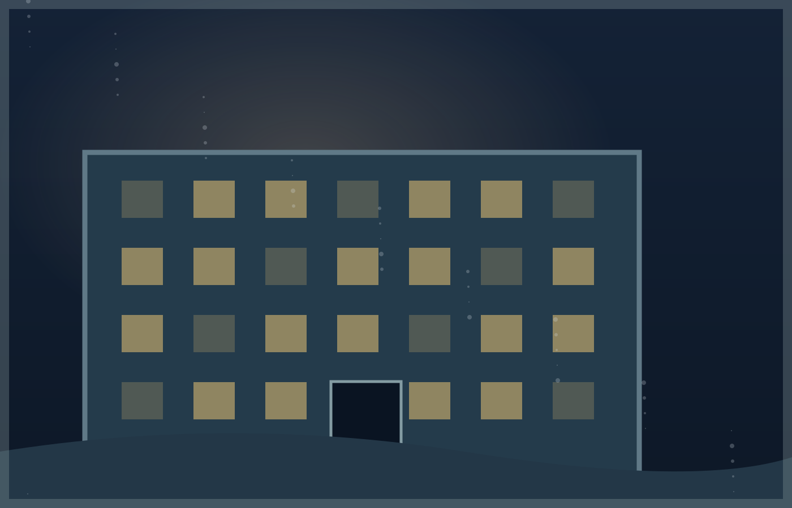
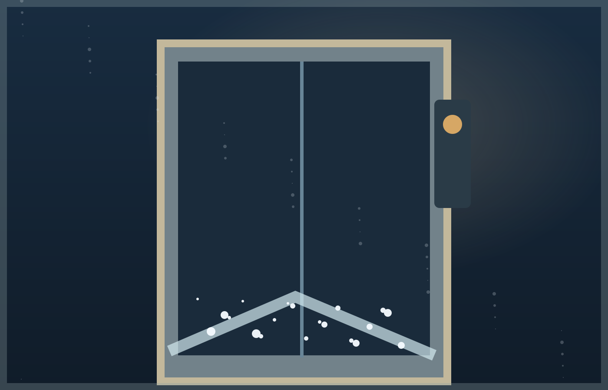
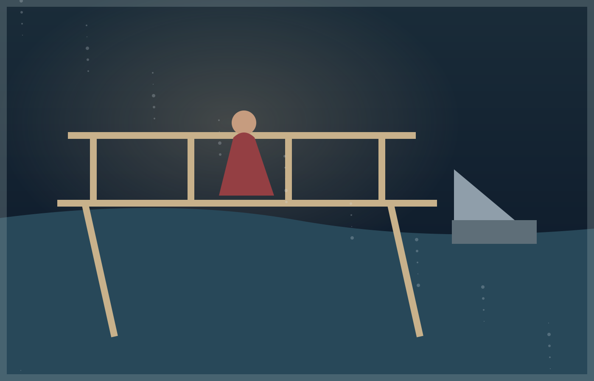
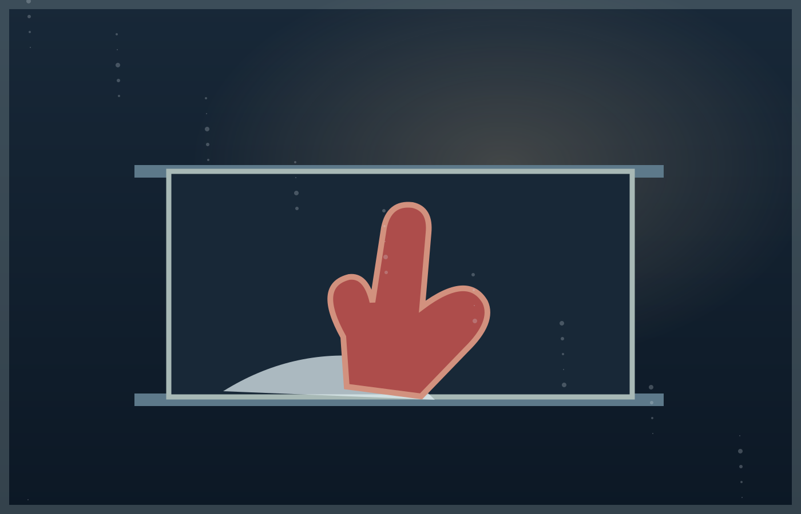

# Девятый этаж, которого не было: ночная смена на Речной

*«Легенды тёмных улиц» · новая оригинальная история · тестовый черновик · без публикации*

В этом доме было восемь этажей. Лифт иногда показывал девятый. И всякий раз после ночного вызова на полу оставался снег — даже когда на улице шёл дождь.

## Снег в закрытой кабине

Вера приехала на Речную в половине третьего ночи. Диспетчер сказал, что у лифта сгорел датчик двери, и добавил странное: «Жильцы жалуются на снег». Вера посмотрела на градусник в машине. Плюс семь, мокрый асфальт, ни одной снежинки за весь ноябрь.

В подъезде пахло обычным ночным домом: пылью от батарей, кошачьим кормом, чужим ужином. А из распахнутого лифта тянуло рекой в феврале. На полу лежала тонкая белая полоска, точно кто-то провёл по линолеуму обледеневшей ладонью. Вера потрогала её пальцем. Настоящий снег. Хрустнул и растаял.

Дом был восьмиэтажный, построенный двадцать четыре года назад. Об этом сообщала табличка у почтовых ящиков. Но индикатор над дверью лифта показывал девятку. Пока Вера доставала телефон, цифра погасла.

## Запись в журнале

У дежурного Семёна Ивановича была комнатка у чёрного входа, где зимой обычно грелись дворники. Старик смотрел на монитор с подъездными камерами и не удивился, когда Вера рассказала про снег. Только выключил звук телевизора.

— После двух вызывают? — спросил он. — Значит, опять не успела.

Вера попросила объяснить. Семён достал из шкафа журнал заявок — толстую тетрадь с клетчатыми листами. Между записями о замене ламп и засорившемся мусоропроводе несколько раз повторялось одно и то же: «2:17. Кабина уходит выше восьмого. Возвращается пустая». Первую такую строку кто-то вывел ещё в ноябре 2002-го, вскоре после заселения дома.

— Вы двадцать четыре года оставляете это без ремонта? — спросила Вера. Семён не обиделся. Он повернул журнал к свету и показал другое: все ночные записи сделаны разными людьми, а почерк в графе «принял заявку» всегда был его.

## Кнопка без номера

Вера сняла переднюю панель управления. Обычная восьмиэтажная схема, провода без следов недавнего вмешательства. За кнопкой восьмого этажа обнаружился старый контакт, не подключённый к плате. На металле кто-то процарапал крошечную девятку. Так иногда оставляют метки монтажники, но от метки не должен сам собой двигаться лифт.

В 2:17 мотор запустился. Двери были открыты, кабину Вера перевела в режим обслуживания, питание вызова отключила. И всё же тросы напряглись. Индикатор мигнул: 8, затем 9. Из пустой шахты раздался звук, похожий на скрип швартового каната. Вера резко нажала аварийный стоп. Вместо привычного сигнала прозвучал детский кашель.

Она не испугалась сразу. Сначала разозлилась: на плохую проводку, на непонятный механизм, на собственные руки, которые дрожали, пока она проверяла контакты. Страх пришёл позже, когда с обратной стороны панели она нашла маленькую шерстяную варежку. Сухую, хотя вокруг всё было мокрым.

## Причал номер девять

Утром Вера вернулась с фотографией варежки. Семён посмотрел на экран и долго молчал. Потом принёс картонную коробку: пожелтевший снимок, вырезку из районной газеты и бронзовый жетон с цифрой 9. На фотографии была деревянная пристань. На её перилах сидела девочка в большом пальто, не по размеру, и болтала ногами над чёрной водой.

До жилого дома здесь стояла речная станция. Не пассажирский вокзал, а несколько причалов, куда привозили рабочих с другого берега. Девятый был самым дальним. В феврале 1979 года ледоход начался раньше, чем ожидали. Лодку с людьми ударило об опору, причал перекосило. В районной заметке перечислялись спасённые. Внизу, почти незаметно, стояла строчка: «Розыск девятилетней Нины К. продолжается».

— Это моя сестра, — сказал Семён. — Я тогда работал на катере. Увёз людей, а за ней вернуться не смог. Когда пристань снесли, поставили дом. Я сюда устроился, чтобы хотя бы знать, где это было.

Вера хотела возразить, что старая газета ничего не объясняет про мотор и кнопки. Но заметила на фотографии перила с вырезанным узором: точно такой же узор был у металлической решётки, которой закрывали машинное отделение лифта.

## Те, кто остаётся ждать

Семён не просил верить в привидения. Он сказал, что зимой иногда слышит, как кто-то стучит из кабины, а летом в подъезде неожиданно пахнет мокрыми досками. Несколько лет назад одна женщина из седьмой квартиры пожаловалась на ребёнка, который стоял перед закрытыми дверями и всё спрашивал, ходит ли здесь катер.

— Почему вы никому не сказали? — спросила Вера.

— Говорил. Сначала смеялись, потом советовали лечиться. А я и сам не уверен, что видел. Только вот варежку знаю. Нина потеряла одну такую в тот день. Вторую наша мать хранила до смерти.

Они поднялись на восьмой этаж пешком. Между пролётами было тихо. Вера обнаружила на стене прямоугольник более светлой краски: там раньше висела старая домовая табличка. Под слоями штукатурки угадывались две выбитые буквы: «ПР». Могли означать что угодно. Семён сказал, что при строительстве часть металла с причала пустили на хозяйственные конструкции.

Вера посмотрела на старика и поняла, что он ждал не доказательства. Ему нужно было услышать, как кто-то ещё произнесёт имя сестры, не понизив голос.

## Последний вызов

На следующую ночь они пришли вдвоём. Вера заранее отключила автоматическую работу кабины, проверила тормоза и оставила дверь машинного помещения под замком. Рисковать жильцами ради догадки она не собиралась. В 2:17 в шахте снова заскрипел канат. Лифт остался неподвижен — только над входом загорелась девятка.

Семён подошёл к закрытым дверям. В руке он держал бронзовый жетон. Тот самый, который выдавали на старом причале вместо билета.

— Нина, — сказал он тихо. — Я помню тебя. И то, что не вернулся, тоже помню.

За дверями не было ни шагов, ни шёпота. Просто что-то легко стукнуло о металл с той стороны. Так ребёнок касается стекла пальцем, чтобы его заметили. Потом девятка исчезла. Вера включила дежурный свет и увидела на пороге крошечный мокрый след. За ним лежала вторая варежка. Совсем маленькая. Семён опустился на корточки, но брать её не стал.

Они просидели на лестнице до рассвета. Старик рассказывал о сестре: как она ненавидела манную кашу, как мастерила кораблики из спичечных коробков, как однажды украла у него фуражку и бросила в реку. Вере впервые за две ночи перестало быть холодно.

## Новая строка

Через неделю жильцы перестали звонить по ночам. Мастер из городского управления заменил неисправный контакт и удивлялся, почему в панели оказалась деталь, которой не было в заводской документации. Семён унёс обе варежки домой. Журнал заявок больше не открывали на странице с 2:17.

Весной Вера ещё раз приехала на Речную — теперь по обычной заявке, из-за скрипучей двери. В комнатке дежурного сидел другой человек. Семён вышел на пенсию и уехал к племяннице. На стене вместо старого монитора висела схема эвакуации. Никакого девятого этажа на ней, конечно, не было.

Перед уходом Вера заглянула в журнал. Последняя запись принадлежала Семёну, хотя в графе времени стояло не 2:17, а 8:45, самое будничное утро. «Причину ночных вызовов больше не наблюдаю. Больше никого не жду».

Она закрыла тетрадь. Снаружи шёл весенний дождь. В доме пахло краской и горячим хлебом из соседнего магазина, и только на секунду ей показалось, что откуда-то тянет рекой. Вера не стала искать источник. Иногда достаточно того, что кто-то наконец дождался ответа.

*Если вам нравятся городские истории, в которых страшное прячется за самыми обычными дверями, подписывайтесь на «Легенды тёмных улиц». Здесь у каждой улицы есть то, о чём она молчит днём.*

---

**Статус:** только редакционный тест. Сайт и RSS не изменены. Иллюстрации — оригинальные векторные рисунки, а не фотографии событий.
